# LEGODT (레고트) — Web Design References

- Date: 2026-11-01
- Task: legodt
- Based on: `output/research/legodt/legodt.md`
- Sources: GDWEB, DBCUT (Pinterest excluded)
- Note: Screenshots are for internal reference only; all rights belong to the original creators and brands. Do not use any of these images on the LEGODT page.

## Content to design for

- **Topic:** Brand introduction one-page site for LEGODT (레고트), a Korean colorful lifestyle/tumbler brand run by Brandworks Korea (CJ ENM). Not related to LEGO.
- **Audience:** Gen Z / MZ who express taste through everyday items ("TUMGGU / 텀꾸" = tumbler decorating), commuters, gym/picnic users, character-collab fans, Japanese/Asian shoppers.
- **Key messages:** "Play My Way"; the signature **loop handle**; **customization** (swappable sleeves, 28-part modular tumbler, keyrings/stickers/straps); many pastel and vivid **colors**; pop-ups and collaborations; honest specs and care notes.
- **Expected sections (from the research plan):** 1 Hero, 2 Brand Story, 3 Signature: the Loop, 4 Lineup, 5 Make Your Own / TUMGGU, 6 Color Palette, 7 Collabs & Pop-ups, 8 Loved By You, 9 Where to Buy, 10 Care Guide / FAQ, 11 Footer.
- **Search keywords used:** 텀블러, 보틀, 레고, 컬러, 캐릭터, 굿즈, 키링, 팝업, 플레이, 토이, 리빙, 라이프스타일, 아이스크림, 캔디, 스티커; DBCUT categories 화학/생활용품, 식품/음료, 유통/판매, 패션/섬유, 취미/게임, Global Picks.

## Reference list

| # | Title | Source | Gallery link | Live site | Image |
|---|---|---|---|---|---|
| 1 | LEGODT 레고트 official store (WINNER PRIZE 2025, agency: Morenbe) | GDWEB | https://www.gdweb.co.kr/sub/view.asp?Txt_fgbn=5&str_no=25098 | https://legodt.kr/ | img/ref01_legodt_official.png, img/ref01_legodt_official_overview.png, img/ref01_legodt_hero.png |
| 2 | IT COLOR 잇컬러 (color education/branding, WINNER PRIZE 2022) | GDWEB | https://www.gdweb.co.kr/sub/view.asp?Txt_fgbn=5&str_no=17780 | https://itcolor.kr | img/ref02_itcolor.png, img/ref02_itcolor_overview.png |
| 3 | weekends 위켄즈 (pop-up/experience agency, WINNER PRIZE 2026) | GDWEB | https://www.gdweb.co.kr/sub/view.asp?Txt_fgbn=5&str_no=27943 | https://weekends.co.kr/ | img/ref03_weekends.png, img/ref03_weekends_overview.png |
| 4 | MUSINSA corporate website 무신사 기업웹사이트 | DBCUT | https://www.dbcut.com/websites/25958 | https://corp.musinsa.com/ | img/ref04_musinsa_corp_tiles.png, img/ref04_musinsa_corp_hero.png, img/ref04_musinsa_corp_timeline.png, img/ref04_musinsa_corp_business.png |
| 5 | Baskin Robbins Korea 배스킨라빈스 | DBCUT | https://www.dbcut.com/websites/25315 | https://www.baskinrobbins.co.kr/ | img/ref05_baskinrobbins_gallery.png, img/ref05_baskinrobbins_live.png |
| 6 | GS Caltex Jigu-TokTok 지구톡톡 (eco-habit campaign) | DBCUT | https://www.dbcut.com/websites/25242 | https://jigutoktok.com/ (no longer resolves, 2026-11-01) | img/ref06_jigutoktok_gallery.png |

Image notes: GDWEB refs are the full-page captures registered on GDWEB, rendered at 1280 px width (`*_overview.png` = the same capture split into columns for a quick look). DBCUT refs are the registered capture from the DBCUT entry (`*_gallery.png` / `*_tiles.png`) plus screenshots of the live site at 1440 px where it was still online.

## Reference analysis

### Ref 1. LEGODT 레고트 official store (GDWEB)
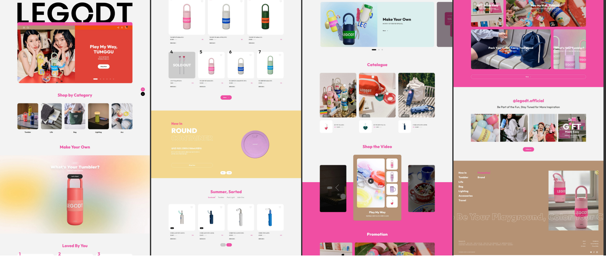
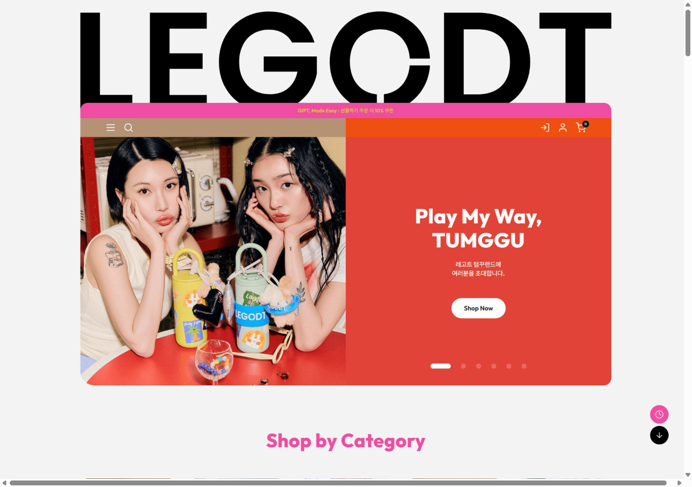
- Links: https://www.gdweb.co.kr/sub/view.asp?Txt_fgbn=5&str_no=25098 / https://legodt.kr/
- GDWEB tags: concept "cute, fun, colorful"; main colors ORANGE, PINK; expression 3D, photo, video, graphics; target 20–30s incl. students and parents.
- Layout: A giant black **"LEGODT" wordmark** spans the full container width above the hero; the hero is a rounded card (≈24 px radius) split 50/50: lifestyle photo (two models holding decorated tumblers) on the left, solid red panel with "Play My Way, TUMGGU" + white pill "Shop Now" button on the right, with pill-shaped slider dots. A slim hot-pink promo bar and a split mocha/orange nav bar sit inside the card. Below: "Shop by Category" (5 square photo tiles), "Make Your Own" (a soft multi-color **mesh-gradient** block with a single tumbler and "What's Your Tumbler?" CTA), "Loved By You" ranked product grid (1, 2, 3… big numerals), a butter-yellow "New In" band with a circular product, "Summer, Sorted" tabbed product grid, Catalogue cards, "Shop the Video" carousel on hot pink, Promotion, Instagram grid (@legodt.official, "Be Part of the Fun…"), and a mocha footer with a huge outlined marquee "Be Your Playground, Color Your C…".
- Color (estimates): background light gray #F3F3F3; ink #111111; hot pink #EC4FA4 (section titles, buttons, video band); red #E2443A (hero panel); orange #F2571C (nav right half); mocha/latte #B7967A (nav left, footer); butter yellow #F2D67C ("New In" band); product pastels (mint, lavender, coral, lemon).
- Typography: Latin geometric sans, very bold (wordmark looks like a custom geometric face whose "O" has a notch like a loop/ring); section titles in a rounded geometric sans (Outfit/Urbanist-like) in hot pink, centered, ~40 px; Korean body in a neutral gothic, small.
- Imagery & graphics: Product cut-outs on white/very light cards; lifestyle photos with decorated tumblers (keyrings, plush charms, stickers); circular and pill shapes; gradient blob background for customization.
- Interaction & motion: Hero slider (6 slides, pill indicator); product carousels with arrow buttons; video carousel; floating round buttons (recent items / scroll-down) at bottom right; footer text marquee.
- Responsive: Not observed (desktop capture only).
- Strengths to borrow: This is the brand's own visual language — giant wordmark hero, hot pink + red/orange + mocha + butter palette, rounded cards and pill buttons, mesh-gradient "Make Your Own" block, big rank numerals for "Loved By You", footer marquee with the phrase "Be Your Playground".
- Caveats: It is a commerce page (prices, carts, many grids). Our page is a brand introduction, so keep fewer grids and more storytelling. Do not copy the logo artwork or photos; use a text wordmark and our own/free images.

### Ref 2. IT COLOR 잇컬러 (GDWEB)
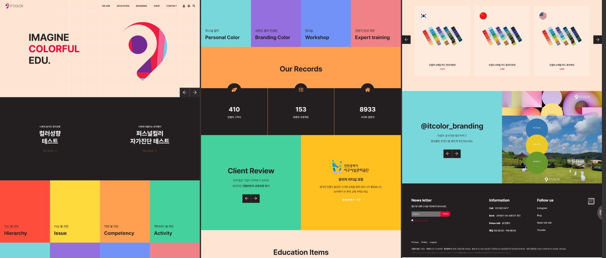
- Links: https://www.gdweb.co.kr/sub/view.asp?Txt_fgbn=5&str_no=17780 / https://itcolor.kr
- GDWEB tags: concept "simple, dynamic, fun, clean"; colors multi (red, yellow, pink, brown, black); expression typography, content.
- Layout: Hero on peach (#FDE3D6) with stacked headline "IMAGINE / COLORFUL / EDU." (middle word in red) and a large abstract colored logo graphic; dark band with two test CTAs; then a **full-bleed 4×2 grid of solid color tiles** (red, yellow, orange, green / cyan, purple, blue, salmon), each tile labeled with a small Korean kicker + bold English title at the bottom-left; orange "Our Records" band with three big counters on dark; split green/yellow review block; product cards with color-chip fans; Instagram block with large color circles labeled with HEX codes.
- Color (estimates): red #FF5240, yellow #FFDB3D, orange #FF9F4A, green #45D49A, cyan #79D8DD, purple #9A6BE0, blue #7A92F6, salmon #F08080, peach #FDE3D6, dark #2A2A2A.
- Typography: Bold sans (Latin) for titles, ~28–40 px; small Korean kicker above each title; counters in bold numerals.
- Imagery & graphics: Almost purely flat color blocks; color circles labeled with hex codes; icons in circles on counters.
- Interaction & motion: Hero slider arrows; tiles likely hover-highlight (not confirmed).
- Responsive: Not observed.
- Strengths to borrow: The **color tile grid** is a direct model for LEGODT's "Color Palette" section (each tile = one official color name, e.g. Mint, Lavender, Coral, Lemon Soda) and the **circle swatches with hex labels**; the counter row fits key numbers (28 parts, 180+ combinations, 4.8/5 rating).
- Caveats: Saturated rainbow is louder than LEGODT's pastel-leaning product colors; tone tiles down toward LEGODT pastels. Dark bands feel corporate — use light backgrounds instead.

### Ref 3. weekends 위켄즈 (GDWEB)
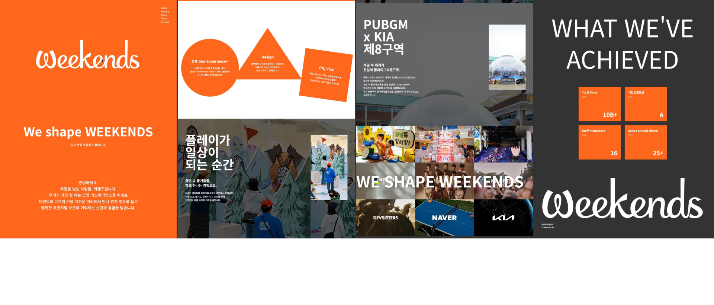
- Links: https://www.gdweb.co.kr/sub/view.asp?Txt_fgbn=5&str_no=27943 / https://weekends.co.kr/
- GDWEB tags: concept "simple, dynamic, fun, trustworthy"; colors black, orange, white; expression motion graphics, photo, product, content.
- Layout: Full-orange intro with a big script logo and "We shape WEEKENDS"; centered Korean intro paragraph; white section with **three geometric shapes (circle, triangle, tilted square)** each holding a service (Off-line Experience+, Design, PR/Viral); project stories as full-bleed photos with huge Korean headlines ("플레이가 일상이 되는 순간") and an inset portrait photo; a mosaic of pop-up photos with "WE SHAPE WEEKENDS" overlay; dark "WHAT WE'VE ACHIEVED" with four orange stat squares; closing giant logo.
- Color (estimates): orange #FF6A1A, white #FFFFFF, charcoal #3A3A3A, black #111111.
- Typography: Script display logo; bold sans for English headlines (all caps, wide); heavy Korean gothic for story headlines (~56–64 px), 3-line stacks.
- Imagery & graphics: Pop-up store photography; flat geometric shapes as content containers, slightly rotated for playfulness.
- Interaction & motion: Motion graphics noted by GDWEB (shapes likely animate in on scroll); photo mosaic.
- Responsive: Not observed.
- Strengths to borrow: It is a pop-up experience agency, so its **pop-up story layout** (full-bleed photo + bold Korean headline + inset photo) and **tilted geometric containers** map well to LEGODT's "Collabs & Pop-ups" and "Signature" sections; one-color confidence (a single vivid accent on white).
- Caveats: Single orange + dark is more corporate than LEGODT; stats-on-dark section should become light/pastel.

### Ref 4. MUSINSA corporate website (DBCUT)
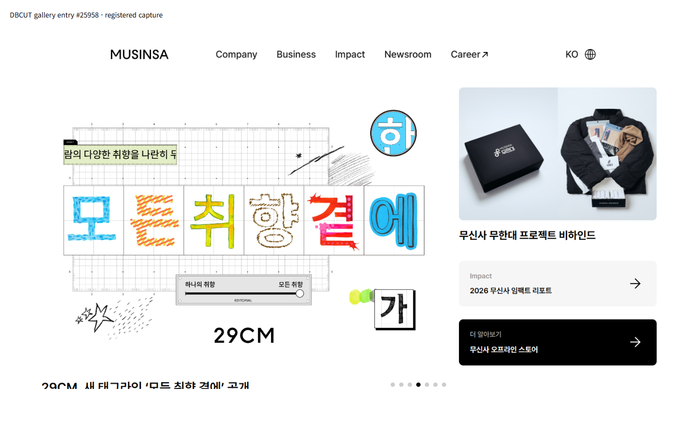
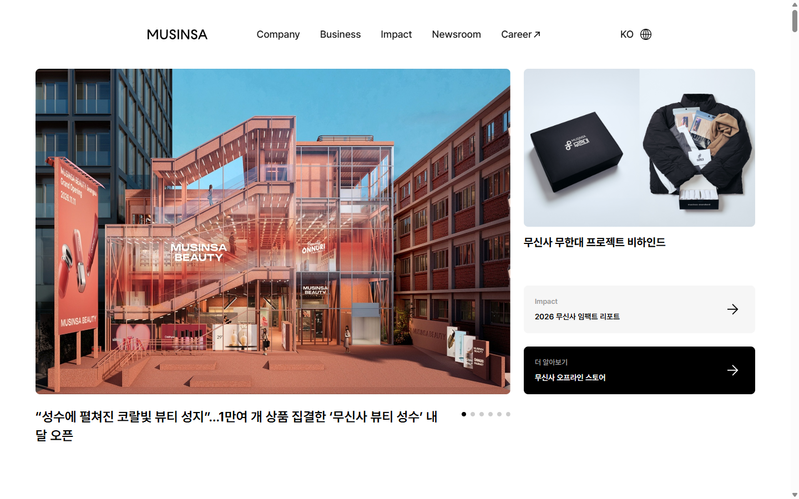
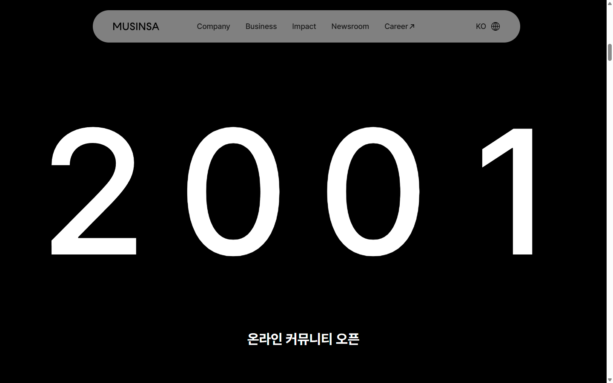
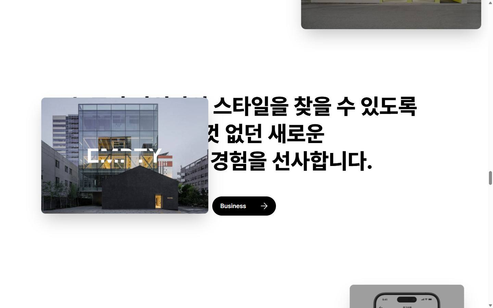
- Links: https://www.dbcut.com/websites/25958 / https://corp.musinsa.com/
- Layout: Clean white news-hero: large rounded image slide (left, ~60%) with headline below and dot indicators; right column with a smaller image card and two pill-like link cards (light gray and black). The DBCUT capture shows a 29CM slide with **hand-drawn, sticker-like Korean letter tiles** ("모든 취향 결에") on a grid paper background, a slider UI "하나의 취향 ↔ 모든 취향", and doodles. Then a centered huge Korean statement with a black pill "Company →" button; a **pinned scroll timeline** where a giant year (2001 → 2025) counts up over full-screen photos with a one-line caption; a statement block where **image cards float/parallax** over the text; Impact and Newsroom sections.
- Color: Mostly white #FFFFFF / black #000000 with photography; the 29CM visual adds cyan, yellow, red, orange.
- Typography: Latin geometric sans for logo and nav; very heavy Korean gothic for statements (~56–64 px, tight tracking); giant light-weight numerals for years (~300 px).
- Imagery & graphics: Real store photos; the 29CM slide uses hand-drawn letter stickers and doodles.
- Interaction & motion: Header turns into a floating **pill nav** with blur on scroll; pinned timeline with year counter; text-reveal + floating cards; smooth scrolling.
- Responsive: Not observed.
- Strengths to borrow: Musinsa/29CM are LEGODT sales channels and share its Gen Z audience. Borrow the **pill floating nav**, the **pinned year timeline** (2024 Musinsa pop-up → 2025 Olive Young N Seongsu → 2025 Japan/Singapore → 2026 Module launch → 2026 Pokémon), the **floating-card statement** for Brand Story, and the **sticker-letter tiles** idea for "TUMGGU" headings.
- Caveats: Monochrome corporate tone; we add LEGODT colors. Keep the heavy scroll-jacking light (a short pinned section, not 7,000 px).

### Ref 5. Baskin Robbins Korea (DBCUT)
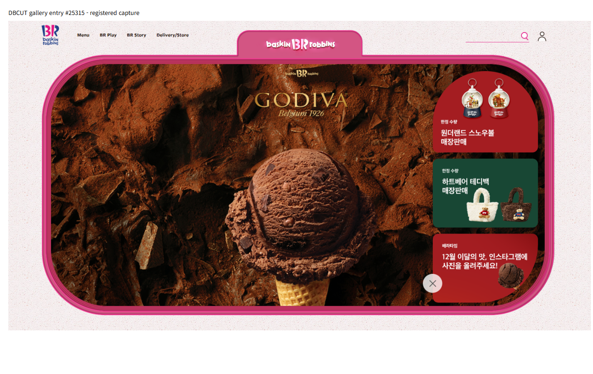
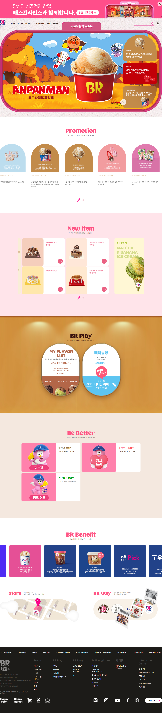
- Links: https://www.dbcut.com/websites/25315 / https://www.baskinrobbins.co.kr/
- Layout: Hero placed inside a **thick rounded pink frame with a top tab** holding the logo (like a container/lid); stacked rounded promo cards on the right of the hero. Sections on alternating pastel bands: "Promotion" with **arch-topped cards**, "New Item" grid on light pink, "BR Play" with **two tall pill/capsule cards** (look like tumblers) on a warm wood-tone band, "Be Better" campaign cards with mascots, "BR Benefit" carousel, "Store"/"BR Way" split, dark footer.
- Color (estimates): BR pink #E0569A / #F27BB0, light pink band #FCDDE8, cream #F7EDE6, chocolate brown #6B3B25, caramel #C98A3E, blue #2C3E9E (logo/benefit), white.
- Typography: Rounded playful display for section titles in pink (~36 px), Korean gothic body; logo-style rounded letters.
- Imagery & graphics: Product cut-outs (cups, cones) inside arch/pill shapes; character illustrations; subtle paper texture.
- Interaction & motion: Hero slider; card carousels with a small pink pagination; hover on cards.
- Responsive: Not observed.
- Strengths to borrow: The **arch and capsule card shapes** echo a tumbler silhouette — ideal for the LEGODT "Lineup" cards (one capsule per model: Mini 200, Standard 400, Module 414…). The **rounded frame with a tab** is a strong hero idea that mirrors the loop-handle lid. Alternating pastel bands give rhythm.
- Caveats: Food-brand warmth (brown/caramel) is off-brand; switch to LEGODT pastels. Too many promo carousels for an intro page.

### Ref 6. GS Caltex Jigu-TokTok 지구톡톡 (DBCUT)
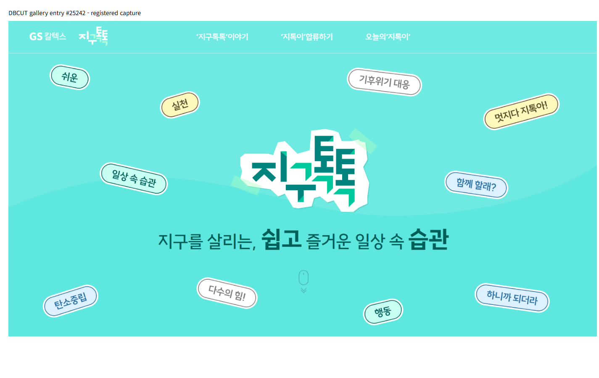
- Links: https://www.dbcut.com/websites/25242 / https://jigutoktok.com/ (live site no longer resolves on 2026-11-01; analysis is from the DBCUT capture only)
- Layout: Full-screen mint hero with a centered **sticker-style logo** (white die-cut outline, slightly torn tape pieces) and a one-line headline with key words in heavier weight; around it, **scattered rotated pill tags** ("쉬운", "실천", "일상 속 습관", "함께 할래?", "하니까 되더라") in mint, yellow, light blue and white with dark outlines; a soft wave divider; a scroll-mouse cue.
- Color (estimates): mint #6EE7DF, deep teal #0F6E63, mint green #1DCB9E, butter #FFF3A6, light blue #DDEBFF, white.
- Typography: Heavy, chunky Korean display for the logo; hand-lettered feel in the tags; mixed weights in the headline (light + extra-bold keywords).
- Imagery & graphics: Pure graphic stickers/tags with 2 px outlines and drop shadow; no photos in the hero.
- Interaction & motion: Likely floating/drifting tags (not verifiable — site offline).
- Responsive: Not observed.
- Strengths to borrow: The **floating sticker tags** are a perfect visual for "TUMGGU" decorating: scatter tags like "Play My Way", "Mix & Match", "28 Parts", "텀꾸", "Loop", around the tumbler; make them draggable in the "Make Your Own" section. The die-cut sticker outline treatment for headings.
- Caveats: Eco-campaign tone and teal palette; adopt only the sticker mechanics, not the colors. Live site is gone, so motion details are unknown.

Alternates seen but not chosen: Jungtoys 정토이즈 (GDWEB, organic blob photo masks, https://www.gdweb.co.kr/sub/view.asp?Txt_fgbn=5&str_no=26053) — useful only for wavy section dividers; PL COLOR and COLORVERSE (GDWEB) — too dark/abstract for this brand.

## Synthesis for this page

### Design direction (3 lines)
1. **Follow LEGODT's own language (Ref 1):** giant wordmark, light-gray base, hot pink as the main accent, red/orange/mocha/butter as supporting blocks, rounded cards and pill buttons.
2. **Make it play:** tumbler-shaped capsule cards (Ref 5), sticker tags you can drag (Ref 6, Ref 4 29CM letters), and a color-tile palette (Ref 2).
3. **Tell the story with motion, lightly:** floating-card brand story and a short pinned year timeline (Ref 4), pop-up stories with bold Korean headlines (Ref 3), and a footer marquee (Ref 1).

### Color palette (CSS custom properties)
The brand UI colors are estimated from the official site capture (Ref 1); the product swatches are estimates for the official color names in the research. None is an official brand spec.

| Token | HEX | Role |
|---|---|---|
| `--c-bg` | #F4F3F1 | Page background (light warm gray) |
| `--c-surface` | #FFFFFF | Cards, product stages |
| `--c-ink` | #141414 | Text, wordmark, outlines |
| `--c-ink-soft` | #5B5B5B | Secondary text (≥4.5:1 on bg) |
| `--c-pink` | #EC4FA4 | Primary accent: section titles (large), buttons, highlights |
| `--c-pink-deep` | #C8307F | Pink text on light bg / hover (AA for small text) |
| `--c-red` | #E2443A | Hero panel, "Play" accents |
| `--c-orange` | #F2571C | Secondary accent, badges |
| `--c-mocha` | #B7967A | Footer, brand story band |
| `--c-butter` | #F4DB86 | "New/Module" band, sticker tags |
| `--sw-mint` | #A8E3CF | Swatch / pastel band |
| `--sw-lavender` | #C9B8F2 | Swatch / pastel band |
| `--sw-coral` | #F59C8B | Swatch |
| `--sw-lemon` | #F7E77D | Swatch ("Lemon Soda") |
| `--sw-skyblue` | #AFD3F4 | Swatch ("Light Blue") |
| `--sw-berry` | #F07DB2 | Swatch ("Berry Pink") |
| `--sw-ivory` | #F7F1E3 | Swatch ("Ivory / Vanilla Cream") |
| `--sw-navy` | #24345F | Swatch ("Navy") |
| `--grad-make` | radial mix of #F7E77D, #F59C8B, #C9B8F2, #A8E3CF | Mesh gradient for "Make Your Own" (Ref 1) |

Contrast rules: white text only on `--c-red`, `--c-pink-deep`, `--c-ink`, `--sw-navy`; ink text on all pastels and on `--c-pink` for large text only.

### Typography (Google Fonts, Korean supported)
- **Latin display:** `Outfit` 700/800 — geometric and rounded, close to the LEGODT site headings (Ref 1). Used for the text wordmark "LEGODT", English hooks ("Play My Way", "Make Your Own", "Loved By You"). Outfit has no Hangul, so always pair with a Korean font in the stack.
- **Korean headings and body:** `Noto Sans KR` 400/500/700/900 — heavy 900 for Korean statements (Ref 3/4 style), 400–500 for body.
- **Accent (sticker tags only):** `Jua` 400 (rounded, playful Hangul + Latin) — for TUMGGU tags and small badges; do not use for paragraphs.
- Stack example: `font-family: "Outfit", "Noto Sans KR", sans-serif;` (Latin glyphs from Outfit, Hangul falls back to Noto Sans KR).
- Scale (fluid): wordmark `clamp(4rem, 16vw, 15rem)` / H2 section title `clamp(2rem, 4.5vw, 3.5rem)` / H3 `clamp(1.25rem, 2.2vw, 1.75rem)` / Korean statement `clamp(1.75rem, 4vw, 3.5rem)` weight 900, line-height 1.25, letter-spacing -0.02em / body 1rem–1.125rem, line-height 1.7 / caption 0.875rem.

### Spacing, radius, shadow, grid
- Spacing scale (4 px base): `--sp-1` 4, `--sp-2` 8, `--sp-3` 12, `--sp-4` 16, `--sp-5` 24, `--sp-6` 32, `--sp-7` 48, `--sp-8` 64, `--sp-9` 96, `--sp-10` 128 (px).
- Section padding: `padding-block: clamp(72px, 10vw, 140px)`.
- Container: max-width 1200 px, side padding `clamp(20px, 5vw, 48px)`; full-bleed bands for color sections.
- Radius: `--r-sm` 12px, `--r-md` 24px (cards, hero card), `--r-lg` 40px (big panels), `--r-pill` 999px (buttons, tags, capsule cards).
- Shadow: soft `0 10px 30px rgba(20,20,20,.08)`; sticker outline `2px solid var(--c-ink)` + `4px 4px 0 var(--c-ink)` offset shadow for tags.
- Breakpoints (mobile first): 768 / 1024 / 1280 px.

### Section-by-section layout (maps to the research plan)
1. **Hero — "LEGODT, Play My Way"** (Ref 1 + Ref 5 + Ref 6): giant text wordmark "LEGODT" across the top; below it a rounded `--r-lg` card split 50/50 — left: lifestyle/product image (free-licensed placeholder), right: `--c-red` panel with "Play My Way," + Korean sub-copy and a white pill CTA "Make Your Own ↓". Optional thick rounded frame with a top tab (Ref 5) to echo the loop lid. 5–6 floating sticker tags drift around the card (Ref 6). Mobile: wordmark scales, card stacks (image on top).
2. **Brand Story** (Ref 4 floating cards): centered heavy Korean statement (e.g. "일상의 물건으로 나를 표현하는 컬러풀 라이프스타일 브랜드") with 2–3 image cards that float/parallax over it; small facts row: Odense roots (Nordic children playing with wooden logs), Brandworks Korea / CJ ENM. Background `--c-bg`.
3. **Signature: the Loop** (Ref 3 geometric containers): 4 feature shapes — circle, capsule, rounded square, tilted square — each with an icon and short text: Loop handle (≥50 mm grip), Wide mouth (77/90 mm), Double-wall vacuum 304 stainless, Swappable silicone sleeve. Shapes in pastel swatches with ink text, slightly rotated; straighten on hover.
4. **Lineup** (Ref 5 capsule/arch cards + Ref 1 product cards): horizontal scroll-snap row (desktop: 4 visible) of tall capsule cards, one per model — Mini 200, Standard 400, Module 414, Multi 600/1000, Handy 700/1000, Tritan 532 — with capacity, one key feature, list price range, each card in a different pastel. Insulation figures only with "제조사 자체 테스트 기준".
5. **Make Your Own / TUMGGU** (Ref 1 mesh gradient + Ref 6 stickers + Ref 4 sticker letters): mesh-gradient band; left: an SVG tumbler built from parts (lid+loop, body, sleeve) whose fills change via swatch buttons; right: three swatch rows (Lid / Body / Sleeve) and a "Random" button; draggable sticker tags (keyring, heart, "텀꾸") that can be dropped on the tumbler. Counter chips: "28 parts", "180+ combinations (2024 pop-up)".
6. **Color Palette** (Ref 2 tile grid): full-bleed grid of color tiles (mobile 2 cols, tablet 3, desktop 4–6), each tile = official color name (Mint, Lavender, Coral, Lemon Soda, Light Blue, Berry Pink, Ivory, Navy, Gradient Pink…) with a small Korean kicker and the hex label in a circle; clicking a tile applies that color to the section 5 tumbler.
7. **Collabs & Pop-ups** (Ref 4 pinned timeline + Ref 3 pop-up stories): short pinned section where a giant year (2024 → 2025 → 2026) changes while event cards slide in: Musinsa Seongsu TUMGGU (2024), Olive Young N Seongsu "PLAY MY WAY" (2025), Japan & Singapore (2025), COEX Module launch (2026), Pokémon x 29CM (2026). Mobile: simple vertical timeline without pinning.
8. **Loved By You** (Ref 1 rank numerals + Ref 2 counters): big rating "4.8 / 5" (Musinsa, 199 reviews, Standard 400 ml, as of 2026-11-01) with large numerals; review-point cards drawn from the research (many colors, loop handle, wide mouth); real quotes marked as placeholders until approved.
9. **Where to Buy**: pill link buttons/logos-as-text — legodt.kr, 29CM, Musinsa, Olive Young, legodt.jp, Instagram @legodt.official / @legodt.japan — on a `--c-butter` band.
10. **Care Guide / FAQ**: accordion (`
`) with rounded `--r-md` items: hand wash only, no microwave/freezer/boiling, not fully leak-proof (carry upright), polish exterior before first use.
11. **Footer** (Ref 1): `--c-mocha` background, huge outlined marquee "Be Your Playground · Play My Way · Color Your Day" (Ref 1 used "Be Your Playground, Color Your C…"), company info (Brandworks Korea), and a disclaimer that this is an unofficial introduction page not affiliated with LEGO.

### Components
- Pill buttons (primary pink filled / ink outline / white on red), pill nav that floats with blur after scroll (Ref 4).
- Sticker tag component: rotated pill, 2 px ink outline, offset shadow, `Jua` font (Ref 6).
- Capsule product card (Ref 5), geometric feature shape (Ref 3), color tile (Ref 2), counter chip, timeline card, accordion, marquee.
- SVG tumbler configurator (lid/loop, body, sleeve as separate paths).

### Interaction & animation ideas
- Hero: wordmark letters rise in with a stagger; sticker tags float slowly (CSS keyframes, ±6 px, different delays); tags draggable with pointer events.
- Scroll reveals: fade-up + slight rotate for shapes and cards (IntersectionObserver; GSAP ScrollTrigger only if the pinned timeline needs it).
- Brand Story: floating image cards with light parallax (Ref 4).
- Lineup: scroll-snap carousel with arrow buttons and keyboard support; card hover lifts and shows a "loop" ring animation.
- Make Your Own: swatch click recolors SVG parts with a 300 ms fill transition; "Random" shuffles; small confetti/sticker pop on change.
- Collabs: pinned year counter (desktop only), simple list on mobile.
- Footer: infinite marquee (CSS `@keyframes translateX`).
- All motion off or reduced under `prefers-reduced-motion` (no floating, no marquee, no pinning).

### Which reference inspires which part
| Page part | Reference |
|---|---|
| Wordmark hero, palette, pill buttons, mesh-gradient "Make Your Own", rank numerals, footer marquee | Ref 1 LEGODT (GDWEB) |
| Color Palette tile grid, hex circles, counters | Ref 2 IT COLOR (GDWEB) |
| Signature geometric feature shapes, pop-up story layout | Ref 3 weekends (GDWEB) |
| Floating pill nav, floating-card Brand Story, pinned year timeline, sticker letter headings | Ref 4 MUSINSA corp (DBCUT) |
| Capsule/arch Lineup cards, tabbed rounded hero frame, alternating pastel bands | Ref 5 Baskin Robbins (DBCUT) |
| Floating/draggable TUMGGU sticker tags, die-cut sticker style | Ref 6 Jigu-TokTok (DBCUT) |
