# LEGODT (레고트) — 웹 디자인 레퍼런스

- 날짜: 2026-11-01
- 작업: legodt
- 기반 자료: `output/research/legodt/legodt.md`
- 출처: GDWEB, DBCUT (핀터레스트 제외)
- 참고: 스크린샷은 내부 참고용이며, 모든 권리는 원 제작자와 브랜드에 있습니다. 이 이미지들을 LEGODT 페이지에 사용하지 마세요.

## 디자인 대상 콘텐츠

- **주제:** 브랜드웍스코리아(CJ ENM)가 운영하는 한국의 컬러풀 라이프스타일/텀블러 브랜드 LEGODT(레고트)의 브랜드 소개 원페이지 사이트. LEGO와는 무관합니다.
- **타깃:** 일상 소품으로 취향을 표현하는 Z/MZ 세대("TUMGGU / 텀꾸" = 텀블러 꾸미기), 출퇴근·헬스·피크닉 사용자, 캐릭터 협업 팬, 일본/아시아 쇼핑객.
- **핵심 메시지:** "Play My Way", 시그니처 **루프 핸들**, **커스터마이징**(교체형 슬리브, 28개 파츠 모듈형 텀블러, 키링/스티커/스트랩), 다양한 파스텔·비비드 **컬러**, 팝업과 협업, 정직한 스펙과 관리 안내.
- **예상 섹션(리서치 기획안 기준):** 1 히어로, 2 브랜드 스토리, 3 시그니처: 루프, 4 라인업, 5 Make Your Own / 텀꾸, 6 컬러 팔레트, 7 협업 & 팝업, 8 Loved By You, 9 구매처, 10 관리 가이드 / FAQ, 11 푸터.
- **사용한 검색어:** 텀블러, 보틀, 레고, 컬러, 캐릭터, 굿즈, 키링, 팝업, 플레이, 토이, 리빙, 라이프스타일, 아이스크림, 캔디, 스티커; DBCUT 카테고리 화학/생활용품, 식품/음료, 유통/판매, 패션/섬유, 취미/게임, Global Picks.

## 레퍼런스 목록

| # | 제목 | 출처 | 갤러리 링크 | 실제 사이트 | 이미지 |
|---|---|---|---|---|---|
| 1 | LEGODT 레고트 공식 스토어 (2025 WINNER PRIZE, 제작사: 모렌비) | GDWEB | https://www.gdweb.co.kr/sub/view.asp?Txt_fgbn=5&str_no=25098 | https://legodt.kr/ | img/ref01_legodt_official.png, img/ref01_legodt_official_overview.png, img/ref01_legodt_hero.png |
| 2 | IT COLOR 잇컬러 (컬러 교육/브랜딩, 2022 WINNER PRIZE) | GDWEB | https://www.gdweb.co.kr/sub/view.asp?Txt_fgbn=5&str_no=17780 | https://itcolor.kr | img/ref02_itcolor.png, img/ref02_itcolor_overview.png |
| 3 | weekends 위켄즈 (팝업/경험 에이전시, 2026 WINNER PRIZE) | GDWEB | https://www.gdweb.co.kr/sub/view.asp?Txt_fgbn=5&str_no=27943 | https://weekends.co.kr/ | img/ref03_weekends.png, img/ref03_weekends_overview.png |
| 4 | MUSINSA 무신사 기업웹사이트 | DBCUT | https://www.dbcut.com/websites/25958 | https://corp.musinsa.com/ | img/ref04_musinsa_corp_tiles.png, img/ref04_musinsa_corp_hero.png, img/ref04_musinsa_corp_timeline.png, img/ref04_musinsa_corp_business.png |
| 5 | 배스킨라빈스 코리아 | DBCUT | https://www.dbcut.com/websites/25315 | https://www.baskinrobbins.co.kr/ | img/ref05_baskinrobbins_gallery.png, img/ref05_baskinrobbins_live.png |
| 6 | GS칼텍스 지구톡톡 (친환경 습관 캠페인) | DBCUT | https://www.dbcut.com/websites/25242 | https://jigutoktok.com/ (2026-11-01 기준 접속 불가) | img/ref06_jigutoktok_gallery.png |

이미지 참고: GDWEB 레퍼런스는 GDWEB에 등록된 전체 페이지 캡처를 1280px 폭으로 렌더링한 것입니다(`*_overview.png`는 같은 캡처를 여러 열로 나눠 한눈에 보도록 한 것). DBCUT 레퍼런스는 DBCUT 게시물에 등록된 캡처(`*_gallery.png` / `*_tiles.png`)와, 아직 운영 중인 경우 1440px 폭의 실제 사이트 스크린샷입니다.

## 레퍼런스 분석

### Ref 1. LEGODT 레고트 공식 스토어 (GDWEB)
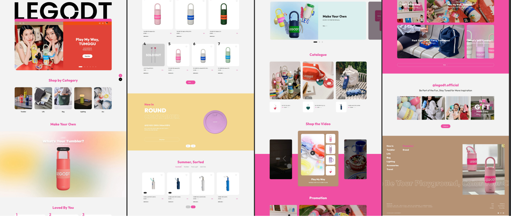
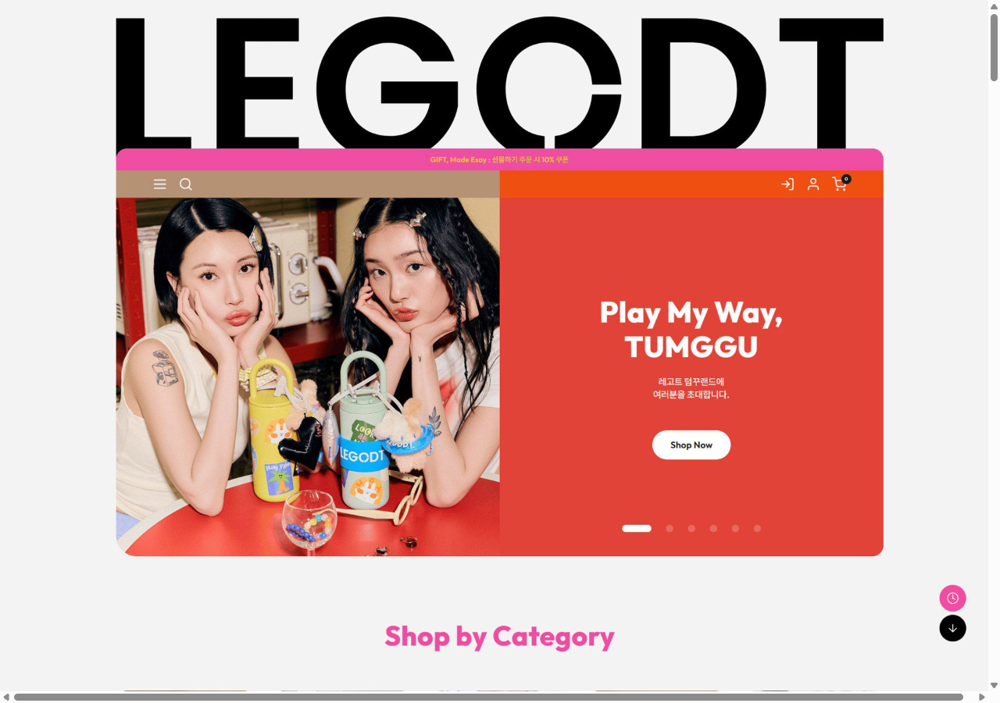
- 링크: https://www.gdweb.co.kr/sub/view.asp?Txt_fgbn=5&str_no=25098 / https://legodt.kr/
- GDWEB 태그: 컨셉 "귀여운, 재미있는, 화려한"; 주색상 ORANGE, PINK; 표현방법 3D, 사진, 영상, 그래픽; 타깃 학생·학부모 포함 20–30대.
- 레이아웃: 거대한 검정 **"LEGODT" 워드마크**가 히어로 위 컨테이너 전체 폭을 차지하고, 히어로는 둥근 카드(약 24px 라운드)를 50/50으로 분할: 왼쪽은 라이프스타일 사진(꾸민 텀블러를 든 모델 두 명), 오른쪽은 "Play My Way, TUMGGU"와 흰색 알약형 "Shop Now" 버튼이 있는 단색 레드 패널, 알약형 슬라이더 인디케이터. 카드 안에 얇은 핫핑크 프로모션 바와 모카/오렌지로 나뉜 내비 바. 아래로: "Shop by Category"(정사각 사진 타일 5개), "Make Your Own"(부드러운 멀티컬러 **메시 그라데이션** 블록에 텀블러 하나와 "What's Your Tumbler?" CTA), 큰 순위 숫자(1, 2, 3…)가 있는 "Loved By You" 상품 그리드, 원형 제품이 있는 버터 옐로 "New In" 밴드, 탭형 "Summer, Sorted" 상품 그리드, 카탈로그 카드, 핫핑크 배경의 "Shop the Video" 캐러셀, 프로모션, 인스타그램 그리드(@legodt.official, "Be Part of the Fun…"), 그리고 거대한 외곽선 마퀴 "Be Your Playground, Color Your C…"가 흐르는 모카색 푸터.
- 컬러(추정): 배경 라이트 그레이 #F3F3F3; 잉크 #111111; 핫핑크 #EC4FA4(섹션 제목, 버튼, 영상 밴드); 레드 #E2443A(히어로 패널); 오렌지 #F2571C(내비 오른쪽); 모카/라테 #B7967A(내비 왼쪽, 푸터); 버터 옐로 #F2D67C("New In" 밴드); 제품 파스텔(민트, 라벤더, 코랄, 레몬).
- 타이포그래피: 매우 굵은 라틴 기하학 산세리프(워드마크는 "O"에 루프/링처럼 홈이 있는 커스텀 기하학 서체로 보임); 섹션 제목은 둥근 기하학 산세리프(Outfit/Urbanist 계열), 핫핑크, 가운데 정렬, 약 40px; 한글 본문은 중립적인 고딕, 작은 크기.
- 이미지 & 그래픽: 흰색/아주 밝은 카드 위 제품 누끼; 키링·인형 참·스티커로 꾸민 텀블러 라이프스타일 사진; 원형·알약형 도형; 커스터마이징용 그라데이션 블롭 배경.
- 인터랙션 & 모션: 히어로 슬라이더(6장, 알약형 인디케이터); 화살표 버튼 상품 캐러셀; 영상 캐러셀; 우측 하단 원형 플로팅 버튼(최근 본 상품/스크롤 다운); 푸터 텍스트 마퀴.
- 반응형: 확인 못 함(데스크톱 캡처만 있음).
- 가져올 장점: 브랜드 자체의 시각 언어 — 거대 워드마크 히어로, 핫핑크 + 레드/오렌지 + 모카 + 버터 팔레트, 둥근 카드와 알약형 버튼, 메시 그라데이션 "Make Your Own" 블록, "Loved By You"의 큰 순위 숫자, "Be Your Playground" 문구의 푸터 마퀴.
- 주의점: 커머스 페이지(가격, 장바구니, 많은 그리드)입니다. 우리 페이지는 브랜드 소개이므로 그리드는 줄이고 스토리텔링을 늘립니다. 로고 아트워크나 사진은 복제하지 말고 텍스트 워드마크와 자체/무료 이미지를 사용합니다.

### Ref 2. IT COLOR 잇컬러 (GDWEB)
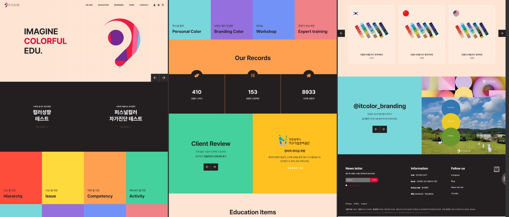
- 링크: https://www.gdweb.co.kr/sub/view.asp?Txt_fgbn=5&str_no=17780 / https://itcolor.kr
- GDWEB 태그: 컨셉 "심플한, 역동적인, 재미있는, 깔끔한"; 컬러 멀티(레드, 옐로, 핑크, 브라운, 블랙); 표현방법 타이포, 콘텐츠.
- 레이아웃: 피치(#FDE3D6) 배경 히어로에 세 줄 헤드라인 "IMAGINE / COLORFUL / EDU."(가운데 단어 레드)와 큰 추상 컬러 로고 그래픽; 테스트 CTA 2개가 있는 다크 밴드; 이어서 **풀블리드 4×2 단색 컬러 타일 그리드**(레드, 옐로, 오렌지, 그린 / 시안, 퍼플, 블루, 살몬), 각 타일 좌하단에 작은 한글 키커 + 굵은 영문 제목; 다크 위 큰 카운터 3개가 있는 오렌지 "Our Records" 밴드; 그린/옐로 분할 후기 블록; 컬러칩 부채가 있는 상품 카드; HEX 코드가 적힌 큰 컬러 원이 있는 인스타그램 블록.
- 컬러(추정): 레드 #FF5240, 옐로 #FFDB3D, 오렌지 #FF9F4A, 그린 #45D49A, 시안 #79D8DD, 퍼플 #9A6BE0, 블루 #7A92F6, 살몬 #F08080, 피치 #FDE3D6, 다크 #2A2A2A.
- 타이포그래피: 제목은 굵은 라틴 산세리프, 약 28–40px; 각 제목 위 작은 한글 키커; 카운터는 굵은 숫자.
- 이미지 & 그래픽: 거의 순수한 플랫 컬러 블록; HEX 코드가 적힌 컬러 원; 카운터의 원형 아이콘.
- 인터랙션 & 모션: 히어로 슬라이더 화살표; 타일 호버 강조 추정(미확인).
- 반응형: 확인 못 함.
- 가져올 장점: **컬러 타일 그리드**는 LEGODT "컬러 팔레트" 섹션의 직접 모델(타일 하나 = 공식 컬러명 하나, 예: Mint, Lavender, Coral, Lemon Soda)이며 **HEX 라벨이 붙은 원형 스와치**도 활용; 카운터 줄은 핵심 숫자(28개 파츠, 180+ 조합, 4.8/5 평점)에 적합.
- 주의점: 채도 높은 무지개색은 LEGODT의 파스텔 위주 제품 컬러보다 시끄러우므로 LEGODT 파스텔 쪽으로 톤 다운. 다크 밴드는 기업적인 느낌이라 밝은 배경으로 대체.

### Ref 3. weekends 위켄즈 (GDWEB)
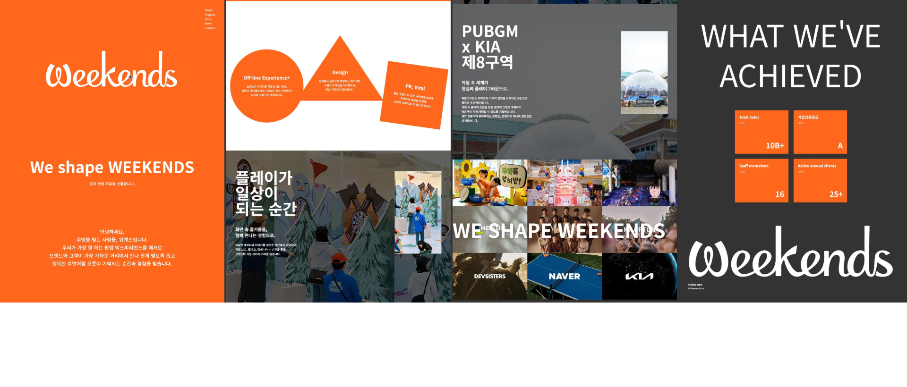
- 링크: https://www.gdweb.co.kr/sub/view.asp?Txt_fgbn=5&str_no=27943 / https://weekends.co.kr/
- GDWEB 태그: 컨셉 "심플한, 역동적인, 재미있는, 신뢰적인"; 컬러 블랙, 오렌지, 화이트; 표현방법 모션그래픽, 사진, 제품, 콘텐츠.
- 레이아웃: 큰 스크립트 로고와 "We shape WEEKENDS"가 있는 전면 오렌지 인트로; 가운데 정렬 한글 소개 문단; 서비스(Off-line Experience+, Design, PR/Viral)를 각각 담은 **세 개의 기하 도형(원, 삼각형, 기울어진 사각형)**이 있는 흰 섹션; 거대한 한글 헤드라인("플레이가 일상이 되는 순간")과 삽입 세로 사진이 있는 풀블리드 사진 프로젝트 스토리; "WE SHAPE WEEKENDS"가 겹쳐진 팝업 사진 모자이크; 오렌지 정사각 통계 4개가 있는 다크 "WHAT WE'VE ACHIEVED"; 마무리 거대 로고.
- 컬러(추정): 오렌지 #FF6A1A, 화이트 #FFFFFF, 차콜 #3A3A3A, 블랙 #111111.
- 타이포그래피: 스크립트 디스플레이 로고; 영문 헤드라인은 굵은 산세리프(대문자, 넓게); 스토리 헤드라인은 무거운 한글 고딕(약 56–64px), 3줄 스택.
- 이미지 & 그래픽: 팝업스토어 사진; 콘텐츠 컨테이너로 쓰인 플랫 기하 도형, 재미를 위해 살짝 회전.
- 인터랙션 & 모션: GDWEB에 모션그래픽 표기(도형이 스크롤 시 등장하는 것으로 추정); 사진 모자이크.
- 반응형: 확인 못 함.
- 가져올 장점: 팝업 경험 에이전시라서 **팝업 스토리 레이아웃**(풀블리드 사진 + 굵은 한글 헤드라인 + 삽입 사진)과 **기울어진 기하 컨테이너**가 LEGODT의 "협업 & 팝업", "시그니처" 섹션에 잘 맞음; 흰 배경에 강렬한 포인트 컬러 하나만 쓰는 자신감.
- 주의점: 오렌지 단색 + 다크는 LEGODT보다 기업적이므로, 다크 통계 섹션은 밝은/파스텔로 바꿀 것.

### Ref 4. MUSINSA 무신사 기업웹사이트 (DBCUT)
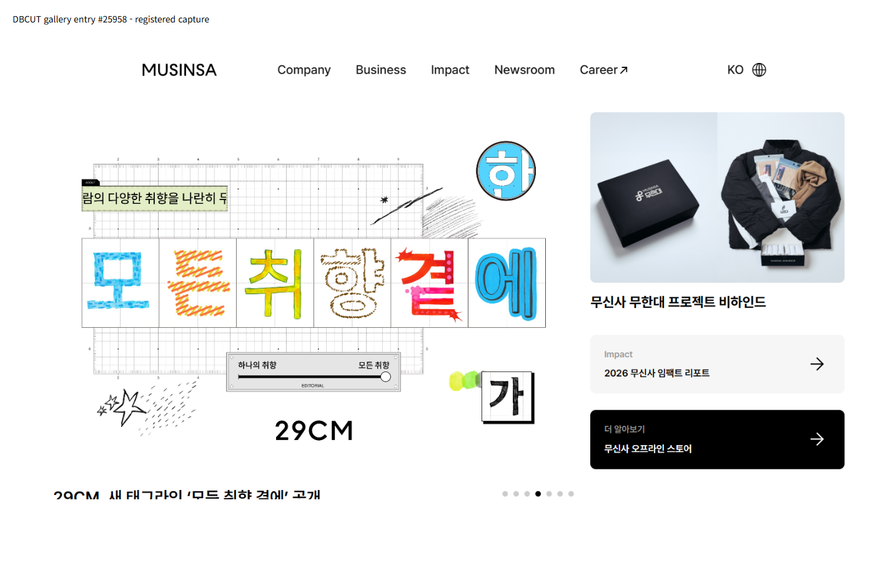
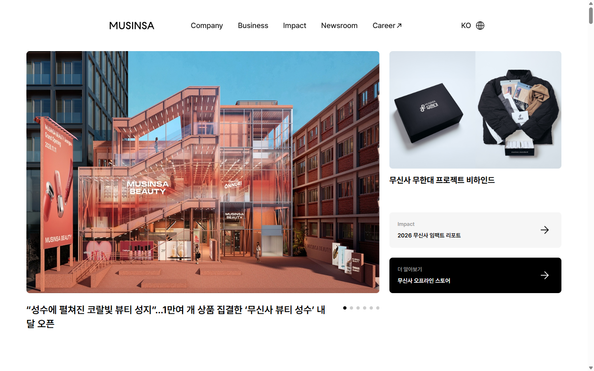
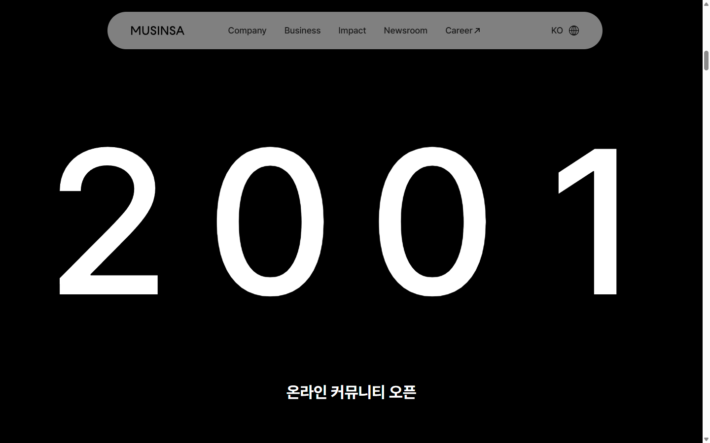
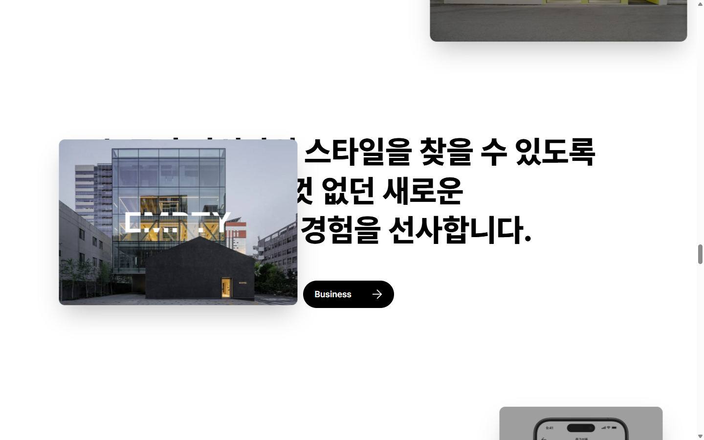
- 링크: https://www.dbcut.com/websites/25958 / https://corp.musinsa.com/
- 레이아웃: 깔끔한 흰색 뉴스 히어로: 큰 둥근 이미지 슬라이드(왼쪽, 약 60%)와 아래 헤드라인, 점 인디케이터; 오른쪽 열에 작은 이미지 카드와 알약형 링크 카드 2개(라이트 그레이, 블랙). DBCUT 캡처에는 모눈종이 배경 위 **손그림 스티커 같은 한글 글자 타일**("모든 취향 결에"), "하나의 취향 ↔ 모든 취향" 슬라이더 UI, 낙서가 있는 29CM 슬라이드가 보임. 이어서 검정 알약형 "Company →" 버튼이 있는 가운데 정렬 거대 한글 선언문; 전체 화면 사진 위로 거대한 연도(2001 → 2025)가 올라가고 한 줄 캡션이 붙는 **고정(pinned) 스크롤 타임라인**; 텍스트 위로 **이미지 카드가 떠다니는(패럴랙스)** 선언문 블록; Impact, Newsroom 섹션.
- 컬러: 대부분 화이트 #FFFFFF / 블랙 #000000과 사진; 29CM 비주얼은 시안, 옐로, 레드, 오렌지를 더함.
- 타이포그래피: 로고와 내비는 라틴 기하학 산세리프; 선언문은 매우 굵은 한글 고딕(약 56–64px, 좁은 자간); 연도는 거대한 가는 숫자(약 300px).
- 이미지 & 그래픽: 실제 매장 사진; 29CM 슬라이드는 손그림 글자 스티커와 낙서.
- 인터랙션 & 모션: 스크롤 시 헤더가 블러가 있는 플로팅 **알약형 내비**로 바뀜; 연도 카운터가 있는 고정 타임라인; 텍스트 리빌 + 떠다니는 카드; 부드러운 스크롤.
- 반응형: 확인 못 함.
- 가져올 장점: 무신사/29CM는 LEGODT 판매 채널이고 Z세대 타깃을 공유. **알약형 플로팅 내비**, **고정 연도 타임라인**(2024 무신사 팝업 → 2025 올리브영 N 성수 → 2025 일본/싱가포르 → 2026 모듈 출시 → 2026 포켓몬), 브랜드 스토리용 **플로팅 카드 선언문**, "텀꾸" 제목용 **스티커 글자 타일** 아이디어를 가져올 것.
- 주의점: 모노톤 기업 톤이므로 LEGODT 컬러를 더함. 스크롤 잡기는 가볍게(7,000px가 아니라 짧은 고정 구간).

### Ref 5. 배스킨라빈스 코리아 (DBCUT)
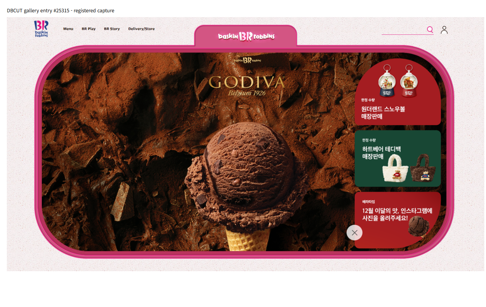
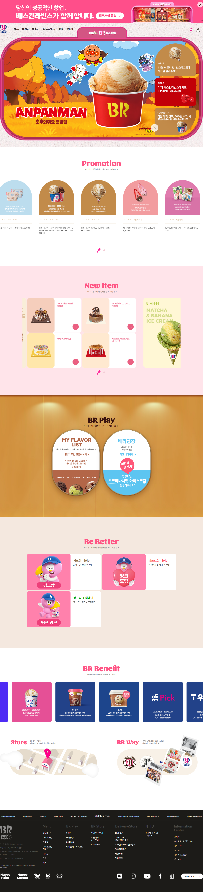
- 링크: https://www.dbcut.com/websites/25315 / https://www.baskinrobbins.co.kr/
- 레이아웃: 로고가 담긴 **위쪽 탭이 달린 두꺼운 둥근 핑크 프레임**(용기/뚜껑 같은 형태) 안에 히어로 배치; 히어로 오른쪽에 쌓인 둥근 프로모션 카드. 번갈아 나오는 파스텔 밴드 섹션: **아치형 상단 카드**의 "Promotion", 연핑크 위 "New Item" 그리드, 따뜻한 나무톤 밴드 위 **세로로 긴 알약/캡슐 카드 2개**(텀블러처럼 보임)의 "BR Play", 마스코트가 있는 "Be Better" 캠페인 카드, "BR Benefit" 캐러셀, "Store"/"BR Way" 분할, 다크 푸터.
- 컬러(추정): BR 핑크 #E0569A / #F27BB0, 연핑크 밴드 #FCDDE8, 크림 #F7EDE6, 초콜릿 브라운 #6B3B25, 캐러멜 #C98A3E, 블루 #2C3E9E(로고/혜택), 화이트.
- 타이포그래피: 섹션 제목은 핑크의 둥글고 재미있는 디스플레이(약 36px), 본문은 한글 고딕; 로고풍 둥근 글자.
- 이미지 & 그래픽: 아치/알약 도형 안의 제품 누끼(컵, 콘); 캐릭터 일러스트; 은은한 종이 질감.
- 인터랙션 & 모션: 히어로 슬라이더; 작은 핑크 페이지네이션의 카드 캐러셀; 카드 호버.
- 반응형: 확인 못 함.
- 가져올 장점: **아치·캡슐 카드 형태**가 텀블러 실루엣과 닮아 LEGODT "라인업" 카드(모델당 캡슐 하나: Mini 200, Standard 400, Module 414…)에 이상적. **탭이 달린 둥근 프레임**은 루프 핸들 뚜껑을 연상시키는 강한 히어로 아이디어. 번갈아 나오는 파스텔 밴드가 리듬을 줌.
- 주의점: 식품 브랜드의 따뜻함(브라운/캐러멜)은 브랜드와 맞지 않으므로 LEGODT 파스텔로 교체. 소개 페이지에는 프로모션 캐러셀이 너무 많음.

### Ref 6. GS칼텍스 지구톡톡 (DBCUT)
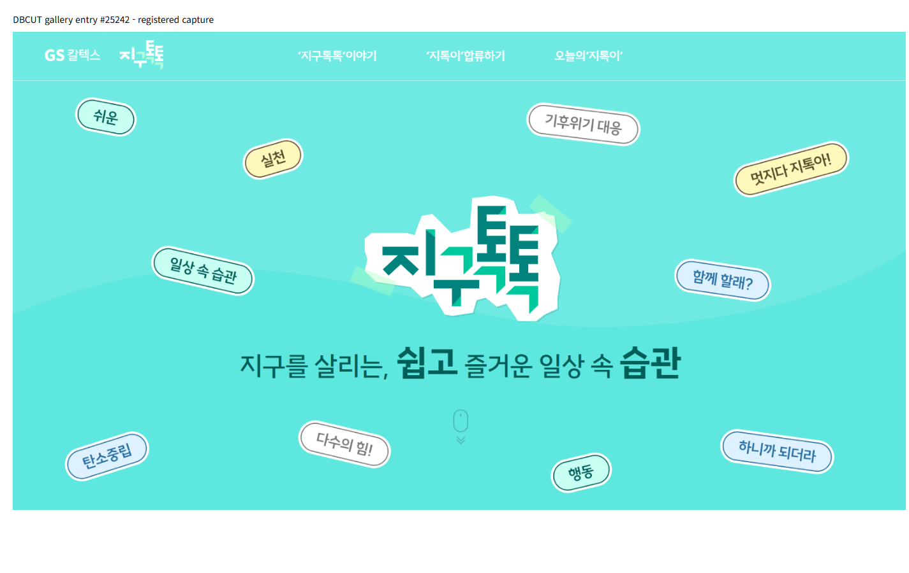
- 링크: https://www.dbcut.com/websites/25242 / https://jigutoktok.com/ (2026-11-01 기준 실제 사이트 접속 불가; DBCUT 캡처만으로 분석)
- 레이아웃: 전면 민트 히어로, 가운데 **스티커 스타일 로고**(흰색 다이컷 외곽선, 살짝 찢어진 테이프 조각)와 핵심 단어만 굵게 한 한 줄 헤드라인; 주변에 **흩어져 회전된 알약형 태그**("쉬운", "실천", "일상 속 습관", "함께 할래?", "하니까 되더라")가 민트, 옐로, 라이트 블루, 화이트에 진한 외곽선; 부드러운 물결 구분선; 스크롤 마우스 표시.
- 컬러(추정): 민트 #6EE7DF, 딥 틸 #0F6E63, 민트 그린 #1DCB9E, 버터 #FFF3A6, 라이트 블루 #DDEBFF, 화이트.
- 타이포그래피: 로고는 두껍고 묵직한 한글 디스플레이; 태그는 손글씨 느낌; 헤드라인은 굵기 혼합(라이트 + 엑스트라볼드 키워드).
- 이미지 & 그래픽: 2px 외곽선과 그림자가 있는 순수 그래픽 스티커/태그; 히어로에 사진 없음.
- 인터랙션 & 모션: 태그가 떠다니는 것으로 추정(사이트가 닫혀 확인 불가).
- 반응형: 확인 못 함.
- 가져올 장점: **떠다니는 스티커 태그**는 "텀꾸" 꾸미기에 딱 맞는 비주얼: "Play My Way", "Mix & Match", "28 Parts", "텀꾸", "Loop" 같은 태그를 텀블러 주변에 흩뿌리고, "Make Your Own" 섹션에서 드래그 가능하게 만들 것. 제목에 다이컷 스티커 외곽선 처리.
- 주의점: 친환경 캠페인 톤과 틸 팔레트이므로 스티커 방식만 채택하고 색은 가져오지 않음. 실제 사이트가 없어 모션 세부는 알 수 없음.

검토했지만 채택하지 않은 후보: 정토이즈(GDWEB, 유기적 블롭 사진 마스크, https://www.gdweb.co.kr/sub/view.asp?Txt_fgbn=5&str_no=26053) — 물결형 섹션 구분선에만 유용; PL COLOR, COLORVERSE(GDWEB) — 이 브랜드에는 너무 어둡고 추상적.

## 이 페이지를 위한 종합안

### 디자인 방향 (3줄)
1. **LEGODT 자체 언어를 따른다(Ref 1):** 거대 워드마크, 라이트 그레이 바탕, 메인 포인트는 핫핑크, 레드/오렌지/모카/버터는 보조 블록, 둥근 카드와 알약형 버튼.
2. **놀이처럼 만든다:** 텀블러 모양 캡슐 카드(Ref 5), 드래그 가능한 스티커 태그(Ref 6, Ref 4의 29CM 글자), 컬러 타일 팔레트(Ref 2).
3. **모션으로 이야기하되 가볍게:** 플로팅 카드 브랜드 스토리와 짧은 고정 연도 타임라인(Ref 4), 굵은 한글 헤드라인의 팝업 스토리(Ref 3), 푸터 마퀴(Ref 1).

### 컬러 팔레트 (CSS 커스텀 프로퍼티)
브랜드 UI 컬러는 공식 사이트 캡처(Ref 1)에서 추정했고, 제품 스와치는 리서치의 공식 컬러명에 대한 추정값입니다. 어느 것도 공식 브랜드 스펙이 아닙니다.

| 토큰 | HEX | 역할 |
|---|---|---|
| `--c-bg` | #F4F3F1 | 페이지 배경(따뜻한 라이트 그레이) |
| `--c-surface` | #FFFFFF | 카드, 제품 무대 |
| `--c-ink` | #141414 | 텍스트, 워드마크, 외곽선 |
| `--c-ink-soft` | #5B5B5B | 보조 텍스트(배경 대비 4.5:1 이상) |
| `--c-pink` | #EC4FA4 | 메인 포인트: 섹션 제목(큰 글자), 버튼, 강조 |
| `--c-pink-deep` | #C8307F | 밝은 배경 위 핑크 텍스트 / 호버(작은 글자 AA) |
| `--c-red` | #E2443A | 히어로 패널, "Play" 포인트 |
| `--c-orange` | #F2571C | 보조 포인트, 배지 |
| `--c-mocha` | #B7967A | 푸터, 브랜드 스토리 밴드 |
| `--c-butter` | #F4DB86 | "New/Module" 밴드, 스티커 태그 |
| `--sw-mint` | #A8E3CF | 스와치 / 파스텔 밴드 |
| `--sw-lavender` | #C9B8F2 | 스와치 / 파스텔 밴드 |
| `--sw-coral` | #F59C8B | 스와치 |
| `--sw-lemon` | #F7E77D | 스와치("Lemon Soda") |
| `--sw-skyblue` | #AFD3F4 | 스와치("Light Blue") |
| `--sw-berry` | #F07DB2 | 스와치("Berry Pink") |
| `--sw-ivory` | #F7F1E3 | 스와치("Ivory / Vanilla Cream") |
| `--sw-navy` | #24345F | 스와치("Navy") |
| `--grad-make` | #F7E77D, #F59C8B, #C9B8F2, #A8E3CF 방사형 혼합 | "Make Your Own"용 메시 그라데이션(Ref 1) |

대비 규칙: 흰 텍스트는 `--c-red`, `--c-pink-deep`, `--c-ink`, `--sw-navy` 위에서만; 파스텔 위에는 잉크 텍스트, `--c-pink` 위 잉크 텍스트는 큰 글자에만.

### 타이포그래피 (Google Fonts, 한글 지원)
- **라틴 디스플레이:** `Outfit` 700/800 — 기하학적이고 둥근 서체로 LEGODT 사이트 제목과 유사(Ref 1). 텍스트 워드마크 "LEGODT", 영문 훅("Play My Way", "Make Your Own", "Loved By You")에 사용. Outfit에는 한글이 없으므로 항상 스택에 한글 폰트를 함께 지정.
- **한글 제목·본문:** `Noto Sans KR` 400/500/700/900 — 한글 선언문은 900(Ref 3/4 스타일), 본문은 400–500.
- **포인트(스티커 태그 전용):** `Jua` 400(둥글고 재미있는 한글 + 라틴) — 텀꾸 태그와 작은 배지에만, 문단에는 사용 금지.
- 스택 예: `font-family: "Outfit", "Noto Sans KR", sans-serif;` (라틴 글리프는 Outfit, 한글은 Noto Sans KR로 대체).
- 스케일(유동): 워드마크 `clamp(4rem, 16vw, 15rem)` / H2 섹션 제목 `clamp(2rem, 4.5vw, 3.5rem)` / H3 `clamp(1.25rem, 2.2vw, 1.75rem)` / 한글 선언문 `clamp(1.75rem, 4vw, 3.5rem)` 굵기 900, 행간 1.25, 자간 -0.02em / 본문 1rem–1.125rem, 행간 1.7 / 캡션 0.875rem.

### 간격, 라운드, 그림자, 그리드
- 간격 스케일(4px 기준): `--sp-1` 4, `--sp-2` 8, `--sp-3` 12, `--sp-4` 16, `--sp-5` 24, `--sp-6` 32, `--sp-7` 48, `--sp-8` 64, `--sp-9` 96, `--sp-10` 128 (px).
- 섹션 패딩: `padding-block: clamp(72px, 10vw, 140px)`.
- 컨테이너: 최대 폭 1200px, 좌우 패딩 `clamp(20px, 5vw, 48px)`; 컬러 섹션은 풀블리드 밴드.
- 라운드: `--r-sm` 12px, `--r-md` 24px(카드, 히어로 카드), `--r-lg` 40px(큰 패널), `--r-pill` 999px(버튼, 태그, 캡슐 카드).
- 그림자: 부드러운 `0 10px 30px rgba(20,20,20,.08)`; 태그용 스티커 외곽선 `2px solid var(--c-ink)` + `4px 4px 0 var(--c-ink)` 오프셋 그림자.
- 브레이크포인트(모바일 우선): 768 / 1024 / 1280px.

### 섹션별 레이아웃 (리서치 기획안 대응)
1. **히어로 — "LEGODT, Play My Way"** (Ref 1 + Ref 5 + Ref 6): 상단에 거대 텍스트 워드마크 "LEGODT"; 그 아래 `--r-lg` 둥근 카드를 50/50 분할 — 왼쪽: 라이프스타일/제품 이미지(무료 라이선스 플레이스홀더), 오른쪽: "Play My Way," + 한글 서브 카피와 흰색 알약형 CTA "Make Your Own ↓"가 있는 `--c-red` 패널. 선택적으로 루프 뚜껑을 연상시키는 위쪽 탭이 달린 두꺼운 둥근 프레임(Ref 5). 카드 주위로 스티커 태그 5–6개가 떠다님(Ref 6). 모바일: 워드마크 축소, 카드 세로 배치(이미지 위).
2. **브랜드 스토리** (Ref 4 플로팅 카드): 가운데 정렬 굵은 한글 선언문(예: "일상의 물건으로 나를 표현하는 컬러풀 라이프스타일 브랜드") 위로 이미지 카드 2–3개가 떠다니며 패럴랙스; 작은 팩트 줄: 오덴세 뿌리(나무 조각을 가지고 노는 북유럽 아이들), 브랜드웍스코리아 / CJ ENM. 배경 `--c-bg`.
3. **시그니처: 루프** (Ref 3 기하 컨테이너): 기능 도형 4개 — 원, 캡슐, 둥근 사각형, 기울어진 사각형 — 각각 아이콘과 짧은 문구: 루프 핸들(그립 50mm 이상), 와이드 입구(77/90mm), 이중 진공 304 스테인리스, 교체형 실리콘 슬리브. 파스텔 스와치에 잉크 텍스트, 살짝 회전; 호버 시 똑바로.
4. **라인업** (Ref 5 캡슐/아치 카드 + Ref 1 상품 카드): 세로로 긴 캡슐 카드의 가로 스크롤 스냅 줄(데스크톱 4개 노출), 모델당 하나 — Mini 200, Standard 400, Module 414, Multi 600/1000, Handy 700/1000, Tritan 532 — 용량, 핵심 기능 하나, 정가 범위, 카드마다 다른 파스텔. 보온·보냉 수치는 "제조사 자체 테스트 기준"과 함께만 표기.
5. **Make Your Own / 텀꾸** (Ref 1 메시 그라데이션 + Ref 6 스티커 + Ref 4 스티커 글자): 메시 그라데이션 밴드; 왼쪽: 파츠(뚜껑+루프, 바디, 슬리브)로 만든 SVG 텀블러, 스와치 버튼으로 색 변경; 오른쪽: 스와치 3줄(뚜껑 / 바디 / 슬리브)과 "랜덤" 버튼; 텀블러 위에 떨어뜨릴 수 있는 드래그 스티커 태그(키링, 하트, "텀꾸"). 카운터 칩: "28 parts", "180+ 조합(2024 팝업)".
6. **컬러 팔레트** (Ref 2 타일 그리드): 컬러 타일 풀블리드 그리드(모바일 2열, 태블릿 3열, 데스크톱 4–6열), 타일마다 공식 컬러명(Mint, Lavender, Coral, Lemon Soda, Light Blue, Berry Pink, Ivory, Navy, Gradient Pink…)과 작은 한글 키커, 원 안의 HEX 라벨; 타일 클릭 시 5번 섹션 텀블러에 그 색 적용.
7. **협업 & 팝업** (Ref 4 고정 타임라인 + Ref 3 팝업 스토리): 거대한 연도(2024 → 2025 → 2026)가 바뀌고 이벤트 카드가 슬라이드인하는 짧은 고정 섹션: 무신사 성수 텀꾸(2024), 올리브영 N 성수 "PLAY MY WAY"(2025), 일본 & 싱가포르(2025), 코엑스 모듈 출시(2026), 포켓몬 x 29CM(2026). 모바일: 고정 없이 단순 세로 타임라인.
8. **Loved By You** (Ref 1 순위 숫자 + Ref 2 카운터): 큰 숫자로 평점 "4.8 / 5"(무신사, 리뷰 199개, Standard 400ml, 2026-11-01 기준); 리서치에서 가져온 리뷰 포인트 카드(다양한 컬러, 루프 핸들, 와이드 입구); 실제 후기 인용은 승인 전까지 플레이스홀더로 표시.
9. **구매처**: `--c-butter` 밴드 위 알약형 링크 버튼/텍스트 로고 — legodt.kr, 29CM, 무신사, 올리브영, legodt.jp, 인스타그램 @legodt.official / @legodt.japan.
10. **관리 가이드 / FAQ**: `--r-md` 둥근 항목의 아코디언(`
`): 손세척만, 전자레인지/냉동/열탕 금지, 완전 밀폐 아님(세워서 휴대), 첫 사용 전 외부 연마.
11. **푸터** (Ref 1): `--c-mocha` 배경, 거대 외곽선 마퀴 "Be Your Playground · Play My Way · Color Your Day"(Ref 1은 "Be Your Playground, Color Your C…" 사용), 회사 정보(브랜드웍스코리아), LEGO와 무관한 비공식 소개 페이지라는 안내문.

### 컴포넌트
- 알약형 버튼(핑크 채움 기본 / 잉크 외곽선 / 레드 위 흰색), 스크롤 후 블러와 함께 떠 있는 알약형 내비(Ref 4).
- 스티커 태그 컴포넌트: 회전된 알약, 2px 잉크 외곽선, 오프셋 그림자, `Jua` 폰트(Ref 6).
- 캡슐 상품 카드(Ref 5), 기하 기능 도형(Ref 3), 컬러 타일(Ref 2), 카운터 칩, 타임라인 카드, 아코디언, 마퀴.
- SVG 텀블러 컨피규레이터(뚜껑/루프, 바디, 슬리브를 별도 path로).

### 인터랙션 & 애니메이션 아이디어
- 히어로: 워드마크 글자가 순차적으로 올라오며 등장; 스티커 태그가 천천히 떠다님(CSS keyframes, ±6px, 서로 다른 지연); 포인터 이벤트로 태그 드래그.
- 스크롤 리빌: 도형과 카드에 페이드업 + 약간의 회전(IntersectionObserver; 고정 타임라인에 필요할 때만 GSAP ScrollTrigger).
- 브랜드 스토리: 가벼운 패럴랙스의 플로팅 이미지 카드(Ref 4).
- 라인업: 화살표 버튼과 키보드를 지원하는 스크롤 스냅 캐러셀; 카드 호버 시 떠오르며 "루프" 링 애니메이션.
- Make Your Own: 스와치 클릭 시 300ms fill 전환으로 SVG 파츠 색 변경; "랜덤"으로 섞기; 변경 시 작은 컨페티/스티커 팝.
- 협업: 고정 연도 카운터(데스크톱만), 모바일은 단순 목록.
- 푸터: 무한 마퀴(CSS `@keyframes translateX`).
- `prefers-reduced-motion`에서는 모든 모션 끄기 또는 축소(떠다니기, 마퀴, 고정 없음).

### 어떤 레퍼런스가 어느 부분에 영감을 주는가
| 페이지 부분 | 레퍼런스 |
|---|---|
| 워드마크 히어로, 팔레트, 알약형 버튼, 메시 그라데이션 "Make Your Own", 순위 숫자, 푸터 마퀴 | Ref 1 LEGODT (GDWEB) |
| 컬러 팔레트 타일 그리드, HEX 원, 카운터 | Ref 2 IT COLOR (GDWEB) |
| 시그니처 기하 기능 도형, 팝업 스토리 레이아웃 | Ref 3 weekends (GDWEB) |
| 플로팅 알약형 내비, 플로팅 카드 브랜드 스토리, 고정 연도 타임라인, 스티커 글자 제목 | Ref 4 MUSINSA 기업 (DBCUT) |
| 캡슐/아치 라인업 카드, 탭 달린 둥근 히어로 프레임, 번갈아 나오는 파스텔 밴드 | Ref 5 배스킨라빈스 (DBCUT) |
| 떠다니는/드래그 가능한 텀꾸 스티커 태그, 다이컷 스티커 스타일 | Ref 6 지구톡톡 (DBCUT) |
